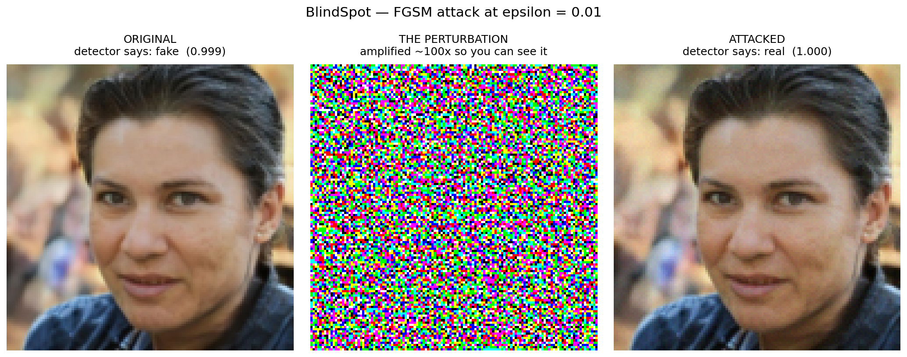
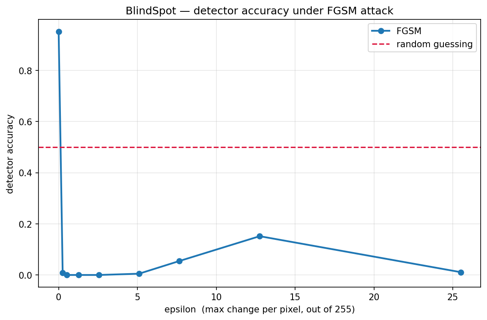

# BlindSpot

**Breaking an AI-generated-face detector with noise you cannot see — and then fixing it.**

### 🔗 [Try it live → blindspott.streamlit.app](https://blindspott.streamlit.app/)

A CNN distinguishes real photographs from StyleGAN-generated faces with **95.22%** accuracy.
A perturbation of roughly **one brightness level out of 255** — invisible to the human eye,
and one that survives being saved as an ordinary 8-bit image — drives it to **0.00%** on all
6,000 held-out validation images.

Adversarial training recovers about half the model's skill at small perturbations, and costs
**24.5 points** of clean accuracy.

Deep Learning (NAI-701) · solo semester project · Harshit Pandey · University of Lucknow
 
---

## Results

| | Clean | Under attack (ε = 0.005) |
|---|---|---|
| **Undefended detector** | 95.22% | **0.00%** |
| **Defended** (adversarial training) | 70.72% | 60.95% |

ε = 0.005 is about 1.3 brightness levels out of 255 and **survives 8-bit rounding**, so it is
reproducible in a real saved image rather than a floating-point artifact.

<p align="center">
  
</p>

Left and right are the same face. The verdicts are opposite.

<p align="center">
  
</p>

Collapse is total by ε = 0.002 — half a brightness level. Not one of 6,000 images survived.

**At 0% accuracy the detector is not merely broken, it is perfectly wrong.** Invert every
answer and you would score 100%. The attack doesn't blind it; it inverts it.

---

## What the attack actually does — and what it doesn't

The attack does **not** change who is in the photograph. A face stays the same face, and a
human sees no difference at all. What flips is the detector's answer to a different question:
*was this image photographed, or synthesized?*

That matters because detectors like this exist **precisely because humans can't make that
call**. The judgment is delegated to a machine. When invisible noise reverses the machine's
answer, there is no backstop — the human reviewer sees an ordinary image, because nothing
visible has changed.

Both directions work:

- **fake → real** — a synthetic face passes an identity check
- **real → fake** — a genuine person's real photograph is flagged as AI-generated

Both reach 0.00% at ε = 0.005.

---

## Run it

**Online:** [blindspott.streamlit.app](https://blindspott.streamlit.app/) — nothing to install.

**Locally:**

```bash
pip install -r requirements.txt
streamlit run streamlit_app.py
```

Four tabs: a live attack you drive with a slider, a plain-English explainer, the experimental
results, and the engineering underneath. CPU only.

| Setting | What happens |
|---|---|
| undefended, ε = 0.005, 8-bit on | the verdict **flips** |
| undefended, ε = 0.001, 8-bit on | the verdict **holds** — the change rounds away |
| defended, ε = 0.005 | it mostly **holds its ground** |

---

## How it works

### The detector

Four blocks of `Conv2d(3×3) → BatchNorm → ReLU → MaxPool`, channels 3 → 32 → 64 → 128 → 128,
image 128×128 → 8×8, then global average pooling and `Linear(128, 2)`.
**241,794 parameters.**

Trained from scratch rather than fine-tuned from a pretrained backbone — the project is about
the mechanism, not the leaderboard. Adam, lr 3e-4 with cosine decay, random horizontal flips,
25 epochs on 45,000 images.

The global average pooling came out of an earlier measurement: in a CNN-vs-MLP comparison the
convolutions cost ~18,800 parameters while the dense head cost over 400,000.

### The attack

```
x_adv = clamp( x + ε · sign( ∂Loss/∂x ) , 0, 1 )
```

Training computes the gradient of the loss with respect to the **weights**. This computes it
with respect to the **input pixels** and steps the other way. Same backpropagation, stopped one
step earlier. FGSM and PGD are both implemented from scratch.

Taking the `sign` rather than the raw gradient bounds every pixel to exactly ε — and that
bound is what keeps the change invisible.

### The defence

Adversarial training: FGSM examples generated from the current model each batch, trained on
clean and attacked images together with correct labels.

---

## Findings

**The detector lives on high-frequency texture.** Blurring the input — destroying fine detail
while leaving the face and composition intact — collapses accuracy from 95.22% to 50.85%, a
coin flip. This also refuted an earlier concern that the model was keying on image framing
rather than AI artifacts.

**That let me predict the fragility in advance.** Recorded 31 October, before any attack code
existed: because the detector depends on exactly the frequency band FGSM perturbs, it should
break at an unusually small budget. Confirmed 5 November.

**The defence shifted the model onto coarser features.** Under blur the undefended model loses
47% of its accuracy; the defended model loses 5%. That migration is what the 24.5 points of
clean accuracy bought — a measured explanation, not a guess.

**PGD is strictly stronger than FGSM**, and FGSM's accuracy *rising* at ε 0.03–0.05 is the
one-step attack overshooting on a curved loss surface — not the model recovering. PGD stays at
zero throughout.

**On the vanishing gradient** (the theory half of the syllabus, measured rather than cited):
in a 20-layer sigmoid network the signal reaching layer 1 is `1.8e-19`, about 10²⁰ times
weaker than at the last layer. Doubling depth squares the ratio, and every line is straight on
a log axis — which is itself the proof that repeated multiplication is the cause.

Of the four standard fixes, **He initialisation alone was the biggest practical win**, carrying
a network past 40 layers where plain ReLU died at 5. Batch norm gave the best gradient ratio
(0.8) but degraded with depth. Residual connections *without* normalization produced the
opposite failure — **exploding** gradients ~1000× too large — which is exactly why real ResNets
pair skips with batch norm.

---

## What this does not show

Stated deliberately.

- **Not that this detector is more fragile than others.** No reference model was trained.
  "Extremely fragile" is supported; "unusually fragile" is not.
- **Not that the attack survives JPEG.** Only 8-bit rounding was tested.
- **Not black-box.** Every attack here had full access to the model's weights.
- **Not that ε = 0.01 was the right training budget** for the defence. Never isolated.
- Single seed throughout.

### Reading the defence honestly

In absolute terms the defence is modest: at the budget it was trained on it scores 0.508
against PGD, barely above the 0.505 always-predict-one-class baseline. Measured as skill above
chance at ε = 0.005, it retains about **52%** of its skill where the undefended model loses all
of it and goes negative. Both numbers belong in any honest summary.

---

## Things that went wrong

- The first training run was **120× too slow**. Profiling showed it was disk-bound, not
  compute-bound — 140,000 small files on a network mount. Restructuring the pipeline to hold
  data in GPU memory cut epochs from 16 minutes to 8 seconds.
- An early depth experiment returned **identical results at every depth**, which made it
  uninterpretable: with no positive control it could not distinguish "depth killed it" from
  "the setup is broken." Rebuilt with a control that had to succeed.
- A prediction that residual + batch norm would win at depth was **wrong**. Plain He
  initialisation beat it.
- Both trained models were lost once to a session timeout.

All dated in `lab-notebook.md`.

---

## Repository

```
blindspot/
├── streamlit_app.py        the deployed demo
├── app/                    local Gradio build
├── notebooks/              01 first model · 02 CNN · 03 data · 04 detector · 05 attack
├── models/                 detector_v3.pth, detector_defended_final.pth
├── results/figures/        all 14 figures
├── lab-notebook.md         every experiment, dated, failures included
├── FOUNDATIONS.md          the concepts from zero, every line of code explained
├── PROJECT_BRIEF.md        narrative of days 1–7
├── DAYS_9_TO_12.md         the attack and defence, cell by cell
└── FINAL_PHASE.md          diagnostics and corrected claims
```

---

## Dataset

[140k Real and Fake Faces](https://www.kaggle.com/datasets/xhlulu/140k-real-and-fake-faces) —
70,000 real photographs (Flickr/FFHQ) and 70,000 StyleGAN-generated, split 100k train /
20k validation / 20k test. Loaded at 128×128 RGB. Labels: `fake = 0`, `real = 1`.

## References

- Goodfellow, Shlens & Szegedy (2014), *Explaining and Harnessing Adversarial Examples* — FGSM
- Madry et al. (2017), *Towards Deep Learning Models Resistant to Adversarial Attacks* — PGD
- Karras et al. (2019), *A Style-Based Generator Architecture for GANs* — StyleGAN

